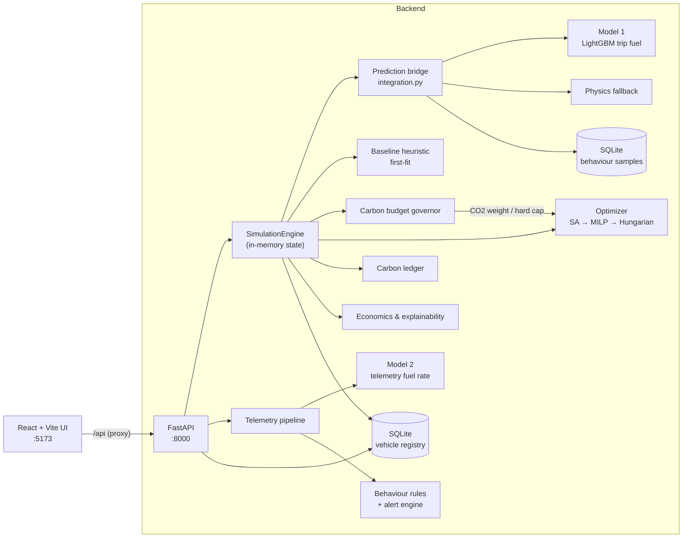

# GreenFleet AI

**Carbon-aware vehicle-to-route dispatch with fuel prediction, optimisation and driver telemetry analysis.**


---

## 🌱 What is GreenFleet AI?

Fleet dispatchers usually send whichever suitable vehicle is free, often a diesel unit, without knowing how much fuel and CO2 that specific vehicle will burn on that specific route. Across a shift, these choices add up to avoidable fuel spend and emissions.

GreenFleet AI predicts fuel use and CO2 for every vehicle-route pair, then assigns vehicles to routes to minimise a combined fuel, CO2 and distance cost. Payload capacity and vehicle availability are respected. A carbon budget governor raises the weight of CO2 in the optimisation as the shift budget fills up, and can enforce the budget as a hard limit.

The optimised plan is compared against a first-available baseline and reported in litres, kg CO2 and INR. A separate telemetry pipeline flags wasteful driving behaviour and feeds driver scores back into future dispatch decisions. All data in this repository is synthetic.

## ✨ Key Features

1. **Fuel and CO2 prediction**: A LightGBM model trained on 6,000 synthetic trips predicts litres per trip. Each estimate comes with a 90% uncertainty band and a risk-adjusted value controlled by a risk-aversion parameter (lambda).
2. **Route assignment optimisation**: Simulated annealing (labelled "quantum-inspired") searches the vehicle-route assignment space. An exact MILP solver (PuLP/CBC) is the fallback, and the Hungarian algorithm is the last resort.
3. **Carbon budget governor**: Tracks projected CO2 against a shift budget (1,500 kg by default) and sets a status of HEALTHY, WARNING, CRITICAL or OVER_BUDGET. It scales the optimiser's CO2 weight from 1.0x up to 5.0x. An optional hard cap turns the budget into a solver constraint.
4. **Baseline vs optimised benchmark**: Compares the optimised plan with a legacy first-fit dispatch heuristic on fuel, CO2, operating cost, utilisation and inefficient assignments.
5. **Commercial economics**: Converts savings into direct fuel cost (INR, per fuel type) and an internal carbon shadow value of ₹2,500 per tonne CO2. It also generates dispatcher recommendations, a non-mutating what-if simulator and a four-scenario comparison matrix.
6. **Driver telemetry analysis**: A second model predicts the expected fuel rate from 1 Hz telemetry. Rule-based detectors flag five inefficient behaviours: excessive revving, harsh acceleration, downhill acceleration, inefficient gear and excessive idling. A stateful alert engine escalates from INFO to WARNING to CRITICAL.
7. **Behaviour-aware dispatch**: Driving-behaviour samples are stored in SQLite. A poor rolling score raises that vehicle's predicted fuel by up to about 45%, which steers the next optimisation away from it.
8. **Carbon reduction ledger**: Records the baseline CO2, optimised CO2, avoided CO2 and shadow value for each optimisation run. Entries are explicitly marked as unverified quantification, not certified credits.
9. **Explainability**: Shows per-assignment factor breakdowns, the best feasible alternative and counterfactuals ("why this vehicle?"), plus 0-100 suitability scores.
10. **Operations dashboard**: A React UI with Plan, Live (Leaflet map), Analytics (including the carbon ledger) and Settings tabs. The Plan tab currently runs a self-contained client-side demo (see Usage), while the What-If, Scenarios, Why, Live telemetry, carbon ledger and Settings panels call the backend.

## 🏗️ System Architecture



A simulation run loads the fleet from the SQLite registry and the routes from the active scenario (Normal, Peak Demand or High Traffic). It predicts fuel and CO2 for every pair and adjusts those predictions using stored driver-behaviour scores. It then builds a baseline plan, runs the optimiser with the CO2 weight set by the carbon governor, and compares the two plans. Each run is recorded in the ledger. The frontend reads state, economics, recommendations and explanations through REST endpoints.

## 🧰 Tech Stack

| Technology | Role |
|---|---|
| Python 3.12 | Backend, ML and simulation |
| FastAPI + Uvicorn | REST API and OpenAPI docs |
| Pydantic / pydantic-settings | API schemas and configuration |
| SQLAlchemy + SQLite | Vehicle registry and behaviour samples |
| LightGBM, scikit-learn | Fuel prediction models and preprocessing pipelines |
| PuLP (CBC), SciPy | MILP solver and Hungarian algorithm |
| NumPy, pandas | Data generation and numerics |
| matplotlib, seaborn | Model evaluation plots |
| React 19 + Vite 8 | Frontend app and dev server |
| Tailwind CSS 4 | Styling |
| Recharts | Charts |
| Leaflet / react-leaflet | Live map (OpenStreetMap tiles, OSRM road geometry) |
| pytest | Test suite |

## 📁 Project Structure

```text
greenfleet-ai/
├── backend/
│   ├── requirements.txt
│   └── app/
│       ├── main.py              # FastAPI app and router registration
│       ├── api/                 # REST routers: fleet, predict, optimize, simulate, carbon, telemetry...
│       ├── core/                # Optimizer, carbon governor, economics, explainability, registries
│       ├── models/              # Pydantic schemas and SQLAlchemy tables
│       └── data/                # Sample routes/vehicles JSON
├── simulation/                  # Demo fleet, scenarios, baseline heuristic, engine, carbon ledger
├── ml_engine/
│   ├── generate_data.py         # Synthetic trip dataset
│   ├── train.py / evaluate.py   # Model 1 training and plots
│   ├── predict.py               # Inference API with uncertainty bands
│   ├── simulation/              # Synthetic telemetry generator
│   ├── training/                # Model 2 training
│   ├── inference/ alerts/       # Telemetry fuel model, behaviour rules, alert engine
│   ├── data/                    # Raw and processed CSVs
│   ├── models/                  # .pkl models, metrics JSON, plots
│   └── tests/
├── frontend/
│   ├── src/App.jsx              # Tabbed UI root
│   ├── src/services/api.js      # Backend client
│   └── src/components/          # plan, live, analytics, dashboard, settings, common
├── tests/                       # Backend pytest suite
├── scripts/verify_p0_demo.py    # End-to-end demo check against a running backend
├── docs/                        # Design notes (architecture, algorithm, API contract...)
├── PROJECT_KNOWLEDGE.txt        # Full end-to-end documentation
└── DATA_README.md               # Data and model file reference
```

## 📊 Dataset

Both datasets are synthetic and generated with seed 42 by scripts in this repository. They are small and stored directly in Git.

| Dataset | Size | Target | Contents |
|---|---|---|---|
| `ml_engine/data/raw/fleet_data.csv` | 6,000 rows x 18 columns | `fuel_consumed_l` | Trips from 60 vehicles (Van, Light Commercial, Truck, Semi-Trailer, Bus; Diesel, Petrol, Hybrid, CNG) on 30 routes, with distance, payload, traffic, speed, road grade and weather |
| `ml_engine/data/raw/synthetic_telemetry.csv` | 5,760 rows x 26 columns | `fuel_consumption_l_100km` | 1 Hz frames: speed, acceleration, RPM, gear, throttle, brake, engine load, slope, road type, traffic level, temperature, idle time, fuel level, behaviour label |

The simulation uses a fixed demo fleet of 20 vehicles and 12 routes, defined in `simulation/dataset.py`. See [DATA_README.md](DATA_README.md) for every data and model file and how to regenerate it.

## 🧠 Model / Implementation Highlights

**Model 1: trip fuel (`ml_engine/train.py`).** This model trains LightGBM, Random Forest and Linear Regression on a 70/15/15 split and keeps the one with the best validation R². LightGBM was selected. It uses 300 trees, a learning rate of 0.05 and 31 leaves. Six engineered features are added: payload ratio, speed deviation from 65 km/h, traffic-speed ratio, grade work, tonnage and weather stress. Results recorded in `ml_engine/models/evaluation_metrics.json`:

| Model | Test MAE (L) | Test RMSE (L) | Test R² | Test MAPE |
|---|---|---|---|---|
| LightGBM (selected) | 1.95 | 3.15 | 0.994 | 4.16% |
| Random Forest | 2.71 | 4.39 | 0.988 | 5.51% |
| Linear Regression | 10.71 | 14.43 | 0.875 | 50.34% |

**Model 2: telemetry fuel rate (`ml_engine/training/train_fuel_model.py`).** This model uses the same candidates and selection rule on telemetry frames, excluding idle frames. Random Forest was selected, with a test MAE of 0.18 L/100 km and a test R² of 0.999 (`telemetry_evaluation_metrics.json`). The split is random at row level, so this score is likely optimistic.

**Uncertainty.** Each prediction carries a band of ±q̂ × dispersion, where q̂ = 1.805 for 90% coverage. The dispersion grows with traffic, payload ratio, age, weather and road grade. The risk-adjusted fuel is the prediction plus λ times the uncertainty.

**Optimiser.** The cost for each pair is risk-adjusted fuel plus weighted CO2, plus distance × traffic × 0.3, plus capacity penalties, scaled by route priority. Simulated annealing starts at temperature 1000, cools by a factor of 0.995 per step and runs for at most 20,000 iterations. It uses drop, add, swap and reassign moves. Each vehicle serves at most one route per planning window.

| Actual vs predicted | Residuals |
|---|---|
|  |  |


## 🚀 Quick Start Guide

### Prerequisites

- Python 3.12
- Node.js 20.19+ or 22.12+ (required by Vite 8) and npm
- Git

### 1. Clone the repository

```bash
git clone https://github.com/kvlokeshkumar/greenfleet-ai.git
cd greenfleet-ai
```

### 2. Create a virtual environment

```bash
python -m venv .venv
```

Windows:

```bash
.venv\Scripts\activate
```

Linux / macOS:

```bash
source .venv/bin/activate
```

### 3. Install Python dependencies

```bash
pip install -r requirements.txt -r backend/requirements.txt -r ml_engine/requirements.txt
```

### 4. Start the backend

```bash
uvicorn backend.app.main:app --host 127.0.0.1 --port 8000 --reload
```

The API runs at `http://127.0.0.1:8000`, with interactive docs at `http://127.0.0.1:8000/docs`. The SQLite file `greenfleet.db` is created automatically.

### 5. Start the frontend (in a second terminal)

```bash
cd frontend
npm install
npm run dev
```

Open `http://localhost:5173`. The dev server proxies `/api` to port 8000. To point the UI at a different backend, copy `frontend/.env.example` to `frontend/.env` and set `VITE_API_URL`. No API keys or secrets are needed.

### 6. Run the tests

```bash
pytest tests ml_engine/tests
```

## 🧪 Usage / Sample Inputs

**Demo flow in the UI:** open the Plan tab and click **Simulate Peak Demand**, then **Plan Routes**. Plan Routes is a client-side demo: it uses a fixed set of 5 vehicles and 5 routes defined in `frontend/src/App.jsx` and shows preset assignments, so it does not call the backend optimiser. These panels do call the backend:

- **What-If**: `/api/simulate/what-if`
- **Scenarios**: `/api/simulate/scenarios`
- **Why**: `/api/assignments/{id}/explanation`
- The dispatcher recommendation: `/api/simulate/recommendation`
- The **Live** tab's telemetry analysis: `/api/predict/telemetry`
- The **Analytics** tab's carbon ledger: `/api/carbon/ledger`
- **Settings**, for vehicle registration and the carbon budget

The ledger only fills after the backend optimiser has run, for example through the API flow below.

**Same flow over the API:**

```bash
curl -X POST http://127.0.0.1:8000/api/simulate/reset
curl -X POST http://127.0.0.1:8000/api/simulate/peak
curl -X POST http://127.0.0.1:8000/api/simulate/optimize
curl http://127.0.0.1:8000/api/simulate/economics
curl http://127.0.0.1:8000/api/assignments/V001/explanation
```

`/optimize` returns both plans and a `benchmark` block (`fuel_saved_l`, `co2_reduced_kg`, `cost_saved`) together with `carbon_budget` (`budget_utilisation_pct`, `status`, `dynamic_co2_penalty`). Exact numbers vary between runs because simulated annealing is stochastic.

**Telemetry analysis:**

```bash
curl -X POST http://127.0.0.1:8000/api/predict/telemetry -H "Content-Type: application/json" -d "{\"window\": [{\"vehicle_id\": \"V001\", \"vehicle_type\": \"Van\", \"fuel_type\": \"Hybrid\", \"speed_kmph\": 72, \"acceleration_mps2\": 3.6, \"rpm\": 3900, \"gear\": 2, \"throttle_position_pct\": 92, \"brake_pressure_pct\": 80, \"engine_load_pct\": 96, \"fuel_level_l\": 44, \"idle_duration_sec\": 25}]}"
```

The response contains `behaviour`, `severity`, `behaviour_score`, `fuel_wasted_l`, `estimated_cost_inr`, `co2_impact_kg`, `remaining_range_km` and a coaching `message`.

**Full scripted check** (with the backend running):

```bash
python scripts/verify_p0_demo.py
```

## 📚 Documentation

- [PROJECT_KNOWLEDGE.txt](PROJECT_KNOWLEDGE.txt): complete end-to-end documentation covering architecture, data, models, configuration, gotchas and open questions
- [DATA_README.md](DATA_README.md): data and model files and how to regenerate them
- [docs/](docs/): design notes on the algorithm, API contract, data schema, carbon budget and explainability

## ⚠️ Known Limitations and Future Work

- All training and demo data is synthetic, so the models have not been validated on real fleet data.
- Simulation state, routes, alerts and the carbon ledger are held in memory and reset on restart. A single shared state serves all users.
- There is no authentication, and CORS is open to all origins. This is a development setup only.
- The uncertainty constants are hard-coded rather than calibrated by a script.
- The telemetry model's random row-level split can leak adjacent frames between train and test.
- The baseline includes a fixed "legacy" fuel factor (1.15x for diesel, 1.05x otherwise), which is part of the reported savings.
- The Plan tab's route planning is a hard-coded client-side demo and is not connected to the backend optimiser. A backend-driven dashboard (`frontend/src/components/dashboard/Dashboard.jsx`) exists but is not mounted in `App.jsx`.
- The Live tab depends on public OpenStreetMap and OSRM servers.
- Future work: ingest real CAN-bus / OBD-II telemetry and retrain, persist simulation state, add authentication and deployment configuration.
